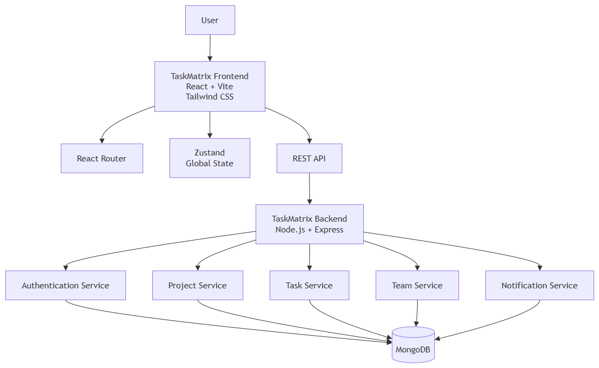
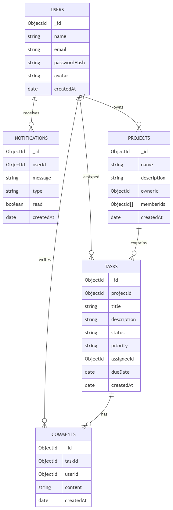
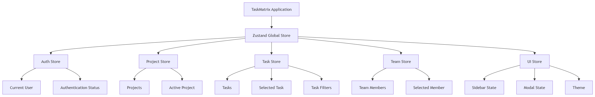

# TaskMatrix

> An Agile Project Management Platform for modern teams.

> **Submission repository name required by the brief:** `prodesk-capstone-TaskMatrix`. The current GitHub repository is still named `TaskMatrix`; rename it in GitHub repository Settings before submitting so the repository-name requirement is actually met.

## Project Overview

TaskMatrix is a planning-stage blueprint for an Agile Project Management platform that helps teams organize projects, manage tasks, collaborate with team members, and monitor project progress from one workspace.

This repository documents the product requirements, prioritized MVP scope, four core UI wireframes, proposed system architecture, MongoDB data model, frontend state organization, and REST API contract. **Sprint 13 is a planning and architecture deliverable; the application is not represented as implemented or production-ready.**

---

## Project Information

| Field | Details |
| --- | --- |
| Project Name | TaskMatrix |
| Designated Track | Agile Project Management |
| Project Type | Enterprise Web Application |
| Development Phase | Capstone Planning |
| Required Repository Name | `prodesk-capstone-TaskMatrix` |
| Current Repository URL | [sumitjoshiakit-web/TaskMatrix](https://github.com/sumitjoshiakit-web/TaskMatrix) — rename still required |
| Repository Visibility | Public |

---

## Tech Stack

### Frontend
- React.js
- Vite
- JavaScript
- Tailwind CSS
- Zustand
- React Router

### Backend
- Node.js
- Express.js
- REST API

### Database
- MongoDB

### Design & Development Tools
- Git
- GitHub
- Figma
- diagrams.net (draw.io)

---

# Product Requirements Document

## 1. Problem Statement

Modern software teams need a centralized platform to manage projects, tasks, team members, deadlines, priorities, and progress.

Managing these activities across separate tools can make it difficult to maintain a clear view of project progress. TaskMatrix is planned as a unified workspace for organizing an Agile workflow from project creation through task completion.

## 2. Target Users

TaskMatrix is designed for:
- Project Managers
- Team Leaders
- Developers
- Designers
- QA Engineers
- Students working in development teams
- Small and medium-sized software teams

## 3. Core Features

### P0 — Mandatory MVP

**Authentication**
- User registration
- User login
- Logout
- Protected application routes
- Basic user profile

**Project Management**
- Create project
- View projects
- Update project
- Delete project
- Project details

**Task Management**
- Create, edit, and delete tasks
- Assign tasks to team members
- Set task priority
- Set task status
- Set due date

**Project Board**
- Backlog
- To Do
- In Progress
- Review
- Done

**Dashboard**
- Total projects
- Total tasks
- Completed tasks
- Pending tasks
- Tasks by priority
- Recent activity

### P1 — Priority Features

**Team Management**
- Add and remove team members
- View team members
- Assign tasks to members

**Task Details**
- Title
- Description
- Status
- Priority
- Assignee
- Due date
- Labels
- Comments
- Activity history

**Search & Filtering**
- Search tasks
- Filter by status
- Filter by priority
- Filter by assignee
- Sort by due date

### P2 — Stretch Features

- Drag-and-drop task management
- Activity timeline
- Notifications
- Dark mode
- Advanced analytics
- Project progress charts
- Role-based permissions
- Real-time collaboration
- Advanced reporting

---

# 4. Application Views

### Authentication
- Login
- Register

### Main Application
- Dashboard
- Projects
- Project Board
- Team Members
- Notifications
- Profile

### Details
- Project Details
- Task Details
- User Details

---

# 5. Project Workflow

```text
Authentication
      ↓
Dashboard
      ↓
Projects
      ↓
Select Project
      ↓
Project Board
      ↓
Create / Select Task
      ↓
Task Details
      ↓
Update Status / Priority / Assignee
      ↓
Task Completed
```

## Task Status Workflow

```text
Backlog → To Do → In Progress → Review → Done
```

---

# 6. UI/UX Wireframes

The Sprint 13 Figma file contains four desktop frames (1440 × 900):

1. **Authentication** — login form and account-creation entry point.
2. **Dashboard** — project/task summary cards, recent tasks, and project progress.
3. **Project Board** — five workflow columns: Backlog, To Do, In Progress, Review, and Done.
4. **Task Details** — task description, status, priority, assignee, due date, labels, comments, and save action.

### Figma Design

[Open the TaskMatrix Figma Wireframes](https://www.figma.com/design/PMAHqdULAMywdVpkL8mq2k/Untitled?node-id=0-1&t=AN6jbjWv9Agci5P7-1)

The link is the design source of truth. The frames are UI/UX mockups; controls shown in the designs are not yet connected to a working application.

---

# 7. System Architecture

TaskMatrix follows a layered full-stack architecture:

```text
User
  ↓
React + Vite Frontend
  ↓
REST API
  ↓
Node.js + Express Backend
  ↓
Application Services
  ↓
MongoDB
```

The backend is planned as separate services/modules for authentication, projects, tasks, team management, and notifications.



---

# 8. Database ERD

The planned MongoDB data model contains five primary collections:

- `users`
- `projects`
- `tasks`
- `comments`
- `notifications`

Important references include:

- `projects.ownerId` → `users._id`
- `projects.memberIds` → `users._id`
- `tasks.projectId` → `projects._id`
- `tasks.assigneeId` → `users._id`
- `comments.taskId` → `tasks._id`
- `comments.userId` → `users._id`
- `notifications.userId` → `users._id`



---

# 9. Mock API Endpoints

## Authentication

```text
POST   /api/auth/register
POST   /api/auth/login
POST   /api/auth/logout
GET    /api/auth/me
```

## Projects

```text
GET    /api/projects
POST   /api/projects
GET    /api/projects/:projectId
PUT    /api/projects/:projectId
DELETE /api/projects/:projectId
```

## Tasks

```text
GET    /api/projects/:projectId/tasks
POST   /api/projects/:projectId/tasks
GET    /api/tasks/:taskId
PUT    /api/tasks/:taskId
DELETE /api/tasks/:taskId
```

## Comments

```text
GET    /api/tasks/:taskId/comments
POST   /api/tasks/:taskId/comments
DELETE /api/comments/:commentId
```

## Users

```text
GET    /api/users
GET    /api/users/:userId
PUT    /api/users/:userId
```

## Notifications

```text
GET    /api/notifications
PUT    /api/notifications/:notificationId/read
```

---

# 10. Frontend State Architecture

Zustand is planned for application-wide state management.

```text
TaskMatrix Application
        ↓
Zustand Global Store
        ├── Auth Store
        │   ├── Current User
        │   └── Authentication Status
        │
        ├── Project Store
        │   ├── Projects
        │   └── Active Project
        │
        ├── Task Store
        │   ├── Tasks
        │   ├── Selected Task
        │   └── Task Filters
        │
        ├── Team Store
        │   ├── Team Members
        │   └── Selected Member
        │
        └── UI Store
            ├── Sidebar State
            ├── Modal State
            └── Theme
```



---

# 11. MongoDB Collection Design

### users
Stores account and profile information.

```text
_id, name, email, passwordHash, avatar, createdAt
```

### projects
Stores project information and membership.

```text
_id, name, description, ownerId, memberIds, createdAt
```

### tasks
Stores project tasks and workflow information.

```text
_id, projectId, title, description, status,
priority, assigneeId, dueDate, createdAt
```

### comments
Stores task-level collaboration messages.

```text
_id, taskId, userId, content, createdAt
```

### notifications
Stores user-specific notifications.

```text
_id, userId, message, type, read, createdAt
```

---

# 12. Architecture Documents

The exported diagrams are committed to the repository and embedded above. Use the links below to open each image directly:

- [System Architecture](docs/architecture/system-architecture.drawio.png)
- [MongoDB Database ERD](docs/architecture/_database-erd.drawio.png)
- [Zustand Frontend State Tree](docs/architecture/_state-tree.drawio.png)
- [Wireframe index and Figma link](docs/wireframes/README.md)

Repository layout:

```text
docs/
├── architecture/
│   ├── system-architecture.drawio.png
│   ├── _database-erd.drawio.png
│   └── _state-tree.drawio.png
└── wireframes/
    └── README.md
```

These are exported PNG assets for the planning deliverable; editable draw.io source files are not currently included.

---

# 13. Development Priorities

| Priority | Area | Status |
| --- | --- | --- |
| P0 | Authentication | Planned |
| P0 | Project Management | Planned |
| P0 | Task Management | Planned |
| P0 | Project Board | Planned |
| P0 | Dashboard | Planned |
| P1 | Team Management | Planned |
| P1 | Task Details | Planned |
| P1 | Search & Filtering | Planned |
| P2 | Drag & Drop | Planned |
| P2 | Notifications | Planned |
| P2 | Analytics | Planned |
| P2 | Real-time Collaboration | Planned |

---

# 14. Sprint 13 Deliverables and Rubric Mapping

| Requirement | Evidence | Status |
| --- | --- | --- |
| Phase 1 / P0: Public GitHub repository named `prodesk-capstone-[ProjectName]` | This repo is public, but its current name is `TaskMatrix`; required final name is `prodesk-capstone-TaskMatrix`. | **Action required: rename repository** |
| Phase 1 / P0: README PRD with Project Name | Project Information table above. | Complete |
| Phase 1 / P0: Designated Track | `Agile Project Management` in Project Information. | Complete |
| Phase 1 / P0: Tech Stack | Frontend, Backend, Database, and Design & Development Tools sections. | Complete |
| Phase 1 / P0: Prioritized core features | P0, P1, and P2 feature lists in Section 3. | Complete |
| Phase 2 / P1: At least 3 core viewports in Figma | Four 1440 × 900 frames: Authentication, Dashboard, Project Board, Task Details. | Designed; evaluator access must be checked |
| Phase 2 / P1: Public Figma link in README | Figma link in Section 6 and `docs/wireframes/README.md`. | Link included; confirm sharing is set to anyone with link can view |
| Phase 3 / P2: Stretch integrations | Optional features listed in Section 3. | Optional; not required for minimum submission |

### Deliverable inventory

- [x] PRD and prioritized P0/P1/P2 scope
- [x] Figma wireframes for four core views
- [x] System architecture diagram
- [x] Database ERD
- [x] Frontend state tree
- [x] Proposed REST API endpoint plan
- [x] MongoDB collection plan
- [x] README image paths checked against repository filenames
- [ ] Rename repository to `prodesk-capstone-TaskMatrix`
- [ ] Verify Figma sharing: anyone with the link can view

---

# 15. Future Development Phases

### Phase 1 — Base MVP
Build authentication, project management, task management, dashboard, and project board.

### Phase 2 — Priority Features
Implement team management, detailed task views, search, filtering, and collaboration features.

### Phase 3 — Optimization & Stretch Features
Add analytics, notifications, drag-and-drop workflows, permissions, and real-time capabilities.

### Phase 4 — Quality & Deployment
Testing, security review, performance optimization, deployment, monitoring, and documentation.

---


# 16. MVP Acceptance Criteria

The following criteria define when the planned P0 MVP should be considered functionally complete. They are acceptance targets, not claims that the features have already been implemented.

| Area | Acceptance criteria |
| --- | --- |
| Authentication | A user can register, log in, retrieve their current session, log out, and cannot access protected views while unauthenticated. |
| Projects | An authorized user can create, view, update, and delete projects; project membership and ownership are enforced by the API. |
| Tasks | An authorized project member can create, edit, view, and delete tasks and set status, priority, assignee, and due date. |
| Project Board | Tasks are grouped into Backlog, To Do, In Progress, Review, and Done; changing a task's status persists through the API. |
| Dashboard | Project/task totals and recent activity are derived from application data rather than hard-coded demo values. |
| Validation & errors | Invalid input receives a useful validation response; loading, empty, success, and failure states are designed into the UI. |
| Responsive UI | Core views remain usable on desktop, tablet, and mobile widths; forms and interactive controls have accessible labels and visible focus states. |

# 17. Key Design Decisions and Assumptions

- **Frontend:** React + Vite, JavaScript, Tailwind CSS, React Router, and Zustand.
- **Backend:** Node.js + Express with a versioned REST API contract at /api.
- **Database:** MongoDB collections with ObjectId references; related records must be checked for authorization at the API boundary.
- **Authentication:** Passwords must be stored as secure hashes, never as plain text. Protected API routes must authenticate the request and authorize access to the requested project/task.
- **API behavior:** Use consistent JSON responses, appropriate HTTP status codes, input validation, and a predictable error shape. The endpoint list in this document is a proposed contract, not a deployed API.
- **Data ownership:** Users may only read or mutate projects and tasks for which they have the required membership/ownership permissions. The backend remains the source of truth for authorization.
- **Planning boundary:** No application code, running backend, live database, or deployed product is claimed by this Sprint 13 repository.

# 18. Submission Review Checklist

- [x] Public repository and project overview
- [x] PRD with target users, problem statement, and P0/P1/P2 feature priorities
- [x] Tech stack and phased development plan
- [x] Figma link with four core desktop views
- [x] System architecture, database ERD, and frontend state-tree exports embedded in this README
- [x] Proposed REST API endpoints and MongoDB collection design
- [x] MVP acceptance criteria and key architecture assumptions
- [x] README image paths match the committed asset filenames
- [ ] Confirm the Figma file is accessible to the evaluator without requesting access
- [ ] Rename the GitHub repository to `prodesk-capstone-TaskMatrix` and verify the new URL
- [ ] Confirm Figma sharing is set to anyone with the link can view

## Project Status

**Planning & Architecture Phase — Sprint 13**

The current phase focuses on product requirements, UI/UX wireframes, system architecture, database design, API planning, and frontend state architecture.
